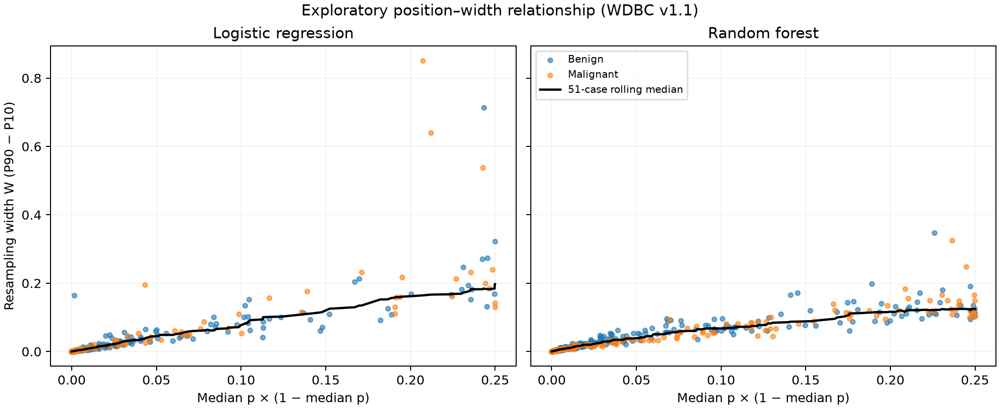

# Beyond Aggregate Performance: WDBC Prediction Stability

**Version 1.1 — exploratory probability-position audit (23 November 2026)**

**Question.** Can redevelopment of a prediction procedure leave its average out-of-sample performance almost unchanged while yielding different probabilities for individual observations? What part of the observed individual-width pattern is associated with the observation's position on the probability scale?

The Wisconsin Diagnostic Breast Cancer (WDBC) dataset provides a small **methodological demonstration**, not a clinically validated cancer classifier. The original, frozen experiment and its results have **not** been refitted or altered in v1.1. The probability-position analyses below were performed **after inspecting the original results**.

## Findings

The original experiment used 50 repeats of stratified five-fold CV, giving 50 held-out predictions per observation and 28,450 per procedure. Its individual stability measure was the central 80% resampling width, $W_i=Q_{.90}(p_{ir})-Q_{.10}(p_{ir})$.

| Frozen original metric | Logistic regression | Random forest |
|---|---:|---:|
| Mean fold-weighted ROC-AUC | 0.994556 | 0.990640 |
| SD across repeats, ROC-AUC | 0.001299 | 0.000924 |
| Mean Brier score | 0.020547 | 0.031696 |
| Median individual width $W_i$ | 0.001004 | 0.010450 |
| P90 individual width | 0.072620 | 0.107858 |
| Maximum individual width | 0.851826 | 0.347762 |

**New post-hoc diagnostics, from the published observation-level CSVs:**

| Diagnostic | Value |
|---|---:|
| Spearman between LR and RF individual widths | 0.72752 |
| Spearman between LR width and $\tilde p(1-\tilde p)$ | 0.99392 |
| Spearman between RF width and $\tilde p(1-\tilde p)$ | 0.99017 |
| Correlation of rank-regression residuals, with each model adjusted for its own probability position | −0.02267 |
| Width concordance among observations with both model medians in [0.05, 0.95] | 0.19265 (n=72) |

Here $\tilde p$ is the **median** held-out probability for that observation and model. The two 0.99 rank correlations **do not mean** that position explains 99% of the variance. The near-zero residual correlation is a descriptive result of one linear rank-adjustment method, not proof of conditional independence. RF does not have the same logistic-link derivative as LR.

**Revised interpretation.** Aggregate metrics do not identify each observation's sensitivity to model redevelopment. But most of the *ordering* of individual widths in this example is strongly associated with probability position. Raw cross-model agreement in width should therefore **not** be described as evidence of a shared, intrinsic category of unstable observations. WDBC_038 has relatively large positive width excess under simple rank-neighborhood baselines in both models; this is an exploratory observation, not a biological or clinical finding.




*Exploratory v1.1 figure: individual resampling width versus median probability position, colored by observed diagnosis, with a local rolling-median reference.*

See [the v1.1 analysis note](analysis/position_adjustment_v11.md) for methods, additional probability-range sensitivities, candidate diagnostics, caveats and source references.

## Reproduce v1.1 without refitting

```bash
conda env create -f environment.yml
conda activate wdbc-prediction-stability
python scripts/analyze_probability_position_v11.py
python -m unittest discover -s tests -v
```

The v1.1 script **reads only** the frozen summaries in `artifacts/results/*_individual_stability.csv`; it writes new files under `analysis/generated_v11/`:

- `position_diagnostics_v11.json` — computed metrics, range sensitivity and neighborhood-window sensitivity
- `positive_excess_candidates_v11.csv` — ten exploratory positive-excess candidates for each model
- `probability_position_v11.png` and `.pdf` — diagnosis-colored width-versus-position plots with a local median baseline

No source predictions, frozen metrics, original figures or notebook outputs are overwritten. The original full analysis can still be reproduced from `01_wdbc_prediction_stability.ipynb`; the primary CLI remains `python scripts/run_wdbc_prediction_stability.py` and is computationally expensive (Random Forest: 8,000 trees per fit).

## Design, provenance and limitations

- **Data:** 569 breast-mass observations, 30 image-derived nuclear-morphology predictors, 212 malignant and 357 benign. Malignancy is coded as 1 in this project.
- **Original methods:** L2-regularized Logistic Regression, 8,000-tree Random Forest and a prevalence-only reference; identical stratified folds across models. Training sets reuse the same finite cohort.
- **Primary estimand:** observation-level P90–P10 spread of genuinely held-out predictions across 50 redevelopment repetitions, **conditional on this dataset and resampling design**. It is not an individual risk confidence interval.
- **Post-hoc scope:** position correlations, linear adjustment of ranks, range restrictions and local rolling-median excess. These are exploratory diagnostics; no clinical thresholds or hypothesis tests were prespecified.
- **No external validation or causal/biological interpretation.** The design does not establish calibrated risk, transportability, independent cohort uncertainty or the cause of a particular observation's width.
- **Perturbation sensitivity:** repeated five-fold CV reuses heavily overlapping training sets; a bootstrap would answer a different question and is not presented as equivalent or necessarily larger.

The [original v1.0 README](https://github.com/Paola-aguirre-ruelas/WDBC-prediction-stability/blob/v1.0.0/README.md) remains unchanged at its tagged revision. The [archived copy](protocol/README_v1_archive.md) includes the primary protocol decisions, exact seeds, detailed QC, figures and prior reproducibility description; its relative links have been corrected for navigation. [Frozen analysis plan](protocol/analysis_plan_v1.md) · [Original scientific proposal](protocol/research_proposal.md) · [v1.1 changelog](V1_1_CHANGELOG.md).

The original 2026-09-26 [notebook audit](metadata/notebook_cleanup_20260926/AUDIT.md) mentions `reproduction_evidence.zip` as audit working-copy evidence; it is **not distributed in this repository**. The audit is retained as a historical record, not represented as a currently downloadable reproduction package.

## Related literature and data attribution

- Riley, R. D., & Collins, G. S. (2023). *Stability of clinical prediction models developed using statistical or machine learning methods*. **Biometrical Journal**, 65, 2200302. https://doi.org/10.1002/bimj.202200302
- Marx, C., Calmon, F., & Ustun, B. (2020). *Predictive Multiplicity in Classification*. **Proceedings of Machine Learning Research**, 119, 6765–6774. https://proceedings.mlr.press/v119/marx20a.html (related but **not** equivalent to resampling instability of one procedure).
- Wolberg, W., Mangasarian, O., Street, N., & Street, W. (1995). *Breast Cancer Wisconsin (Diagnostic)* [Dataset]. UCI Machine Learning Repository. https://doi.org/10.24432/C5DW2B. Data accessed through `sklearn.datasets.load_breast_cancer`.

**License:** MIT (code and repository materials); underlying WDBC dataset remains attributed to its original source. For repository citation, see [`CITATION.cff`](CITATION.cff). No Zenodo DOI has been assigned.
